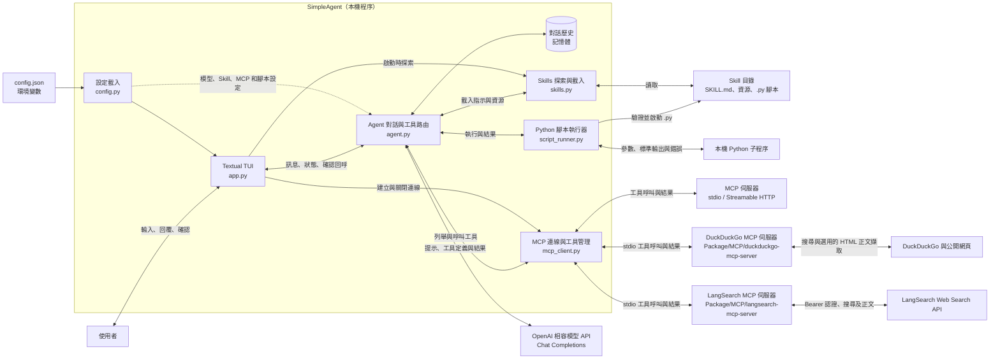
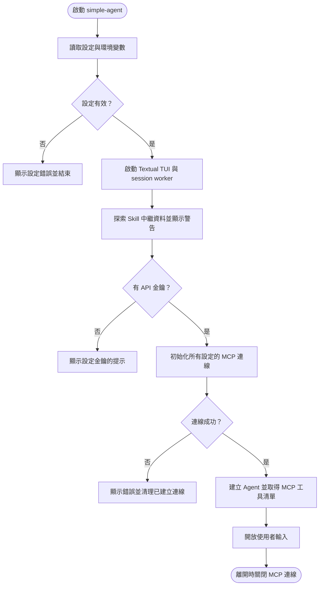
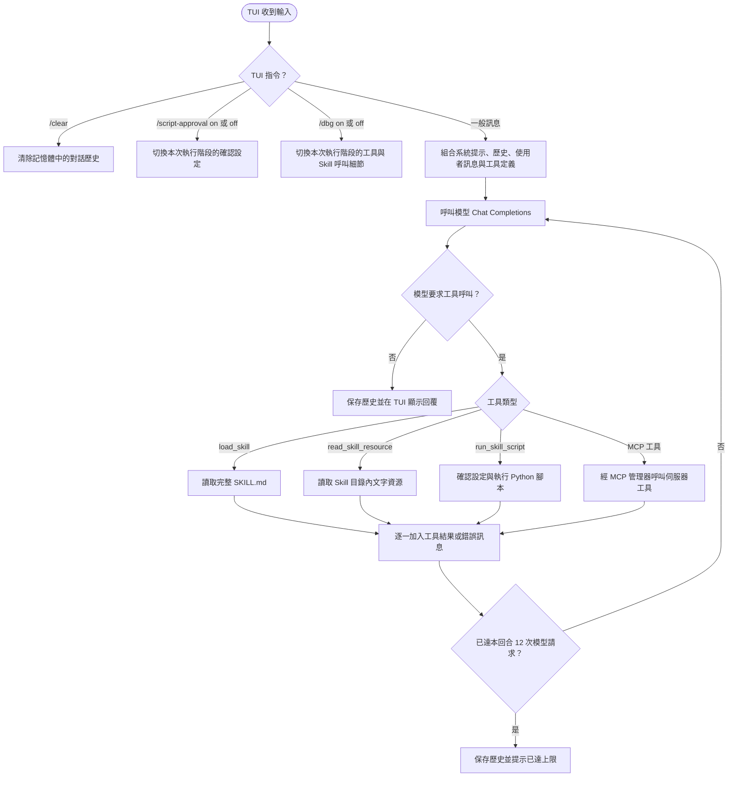
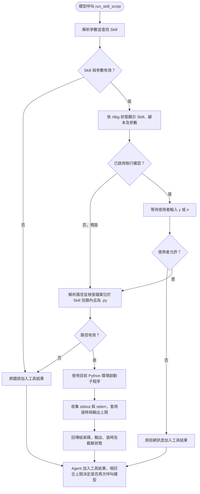
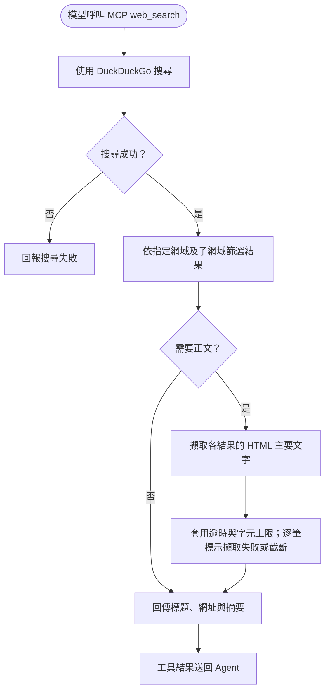

# SimpleAgent 系統架構與處理流程

本文件依目前工作目錄中的實作整理，涵蓋 TUI、模型對話、Agent Skills、Skill Python 腳本及 MCP 工具。圖表使用 Mermaid。

## 系統架構

| 元件 | 職責 |
| --- | --- |
| [設定載入](../src/simple_agent/config.py) | 讀取 `config.json` 與環境變數，驗證腳本設定。 |
| [TUI](../src/simple_agent/app.py) | 以 Markdown 顯示 Agent 回覆，顯示對話、工具狀態與確認提示，處理 `/clear`、`/script-approval`、`/dbg` 等指令。 |
| [Agent](../src/simple_agent/agent.py) | 組合對話與工具定義、呼叫模型、依序執行工具，並維護記憶體中的歷史。 |
| [Skills](../src/simple_agent/skills.py) | 探索 `SKILL.md` 中繼資料，按需載入完整指示或 Skill 目錄內的文字資源。 |
| [腳本執行器](../src/simple_agent/script_runner.py) | 驗證 Skill 內的 `.py` 路徑，啟動 Python 子程序，收集有限輸出並處理逾時。 |
| [MCP 管理器](../src/simple_agent/mcp_client.py) | 建立 MCP 連線、依 envPassthrough 與 env 傳入 stdio 環境變數、探索工具、轉換工具定義並路由呼叫。 |

## 啟動流程

## 對話與工具處理流程

工具結果會加入對話，再交由模型決定是否繼續呼叫工具或產生回覆。同一則模型回覆若包含多個工具呼叫，Agent 會依序處理。若第 12 次模型請求仍要求工具，Agent 會執行工具並保存結果，但須等待下一次使用者輸入才再次呼叫模型。`/clear` 只清除目前程序記憶體中的對話歷史。

## Skill Python 腳本流程

腳本工作目錄是啟動 SimpleAgent 的目錄，標準輸入關閉，且不經 shell。預設逾時 60 秒，標準輸出與錯誤輸出共用 32 KiB 上限，均可透過設定調整。腳本繼承本機使用者的權限與環境；路徑檢查並非沙箱。Windows 上若腳本先結束，其仍在執行的子程序可能無法自動終止。

MCP 工具與 Skill 腳本使用不同的執行路徑：腳本確認開關不適用於 MCP 工具。MCP 的 resources、prompts 與 OAuth 目前尚未實作。

## DuckDuckGo 搜尋流程

